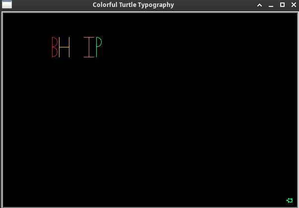

# 🐢 Colorful Turtle Typography

A custom Python project built using Turtle graphics to dynamically render text strings with individual character functions, automated loops, and vibrant color cycling.

## 📸 Preview

## ✨ Supported Characters (Current)
The engine currently supports the following characters, with more letters coming soon:
* **`b`**
* **`h`**
* **`i`**
* **`p`**
* **`space`** (for word spacing)

## 🚀 Features
* **Dynamic Character Rendering:** Automatically loops through input strings and invokes matching functions dynamically using Python's `globals()`.
* **Automated Color Cycling:** Loops through a diverse list of vibrant colors using modulo arithmetic (`idx % len(colors)`).
* **Custom Primitives:** Built from scratch using foundational movement functions like vertical lines (`vl`), horizontal lines (`hl`), and half-circle curves (`hcr`).
* **Heading Control:** Standardized turtle heading control to prevent positional drift during rendering.

